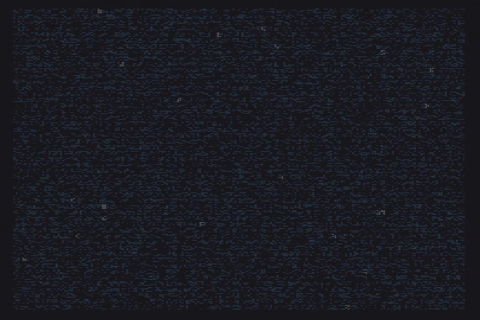

# grava

A terminal audio visualizer for Linux that draws **sand on a vibrating plate**.
Like [cava](https://github.com/karlstav/cava), it listens to whatever the
computer is playing. Instead of bars it shows a Chladni figure: grains are
thrown off the parts of a plate or drum head that move and collect on the
nodal lines where the surface stays still. Every note has its own figure, and
when the note changes the sand flows into the new one.



*The sand settling into its first figures while Vivaldi's "Summer" plays.*

- Fine sand made of Braille dots (or quadrants, half blocks, ASCII), 60 fps, no flicker.
- Musically meaningful: the same note gives the same figure, higher notes give more
  intricate figures, louder music shakes harder, beats make the sand jump, and in
  silence the sand rests like on a real plate.
- Works with no configuration on a stock PipeWire or PulseAudio desktop. No
  system libraries are needed to build it, and it runs on glibc and musl.
- Riceable: every color is a key, themes (built-in, files, pywal), borders, a
  status line, glyph sets, layout, and live reload of the config and the theme.
- Costs next to nothing when nothing moves: a resting plate is not redrawn.

## Install

grava needs Rust 1.88 or newer to build, a linker, and nothing else.

```sh
cargo install --locked --git https://github.com/QinZinn/Grava
grava
```

From a clone: `cargo install --locked --path .`, or `cargo build --release` and
copy `target/release/grava` anywhere on your `PATH`.

**Prebuilt binaries.** Each tagged release on the
[releases page](https://github.com/QinZinn/Grava/releases) carries fully static
`x86_64` and `aarch64` binaries (musl, default features) with the man page and
the shell completions. Unpack and run, no installation needed.

**Distributions.** Templates for the AUR (`grava` and `grava-git`), Void Linux
(`xbps-src`) and Fedora (COPR) are in [`packaging/`](packaging/). They are not
published packages yet.

### Optional audio backends

The default `pulse` backend is pure Rust. It talks the PulseAudio protocol
directly, so it works with PulseAudio and, through `pipewire-pulse`, with
PipeWire, and is what most desktops need. Two more backends link system
libraries and are off by default:

| Feature | For | Fedora | Debian / Ubuntu | Arch | Void |
|---|---|---|---|---|---|
| `pipewire` | native PipeWire | `pipewire-devel clang-devel` | `libpipewire-0.3-dev libclang-dev pkg-config` | `libpipewire clang` | `pipewire-devel clang` |
| `alsa` | an ALSA loopback (`snd-aloop`) without a sound server | `alsa-lib-devel` | `libasound2-dev pkg-config` | `alsa-lib` | `alsa-lib-devel` |

```sh
cargo install --locked --git https://github.com/QinZinn/Grava --features pipewire,alsa
```

`grava --version` lists the backends that were compiled in. Without `pipewire`,
plain `grava` still records through `pipewire-pulse`.

## Quick start

```sh
grava                 # the monitor of the default output: what you hear
grava -i demo         # a built-in melody, no audio system needed
grava --list-sources  # what it can record, with the default marked
```

| Key | Action |
|---|---|
| `q` `Esc` `Ctrl-C` | quit |
| `Space` | freeze the sand |
| `s` | scatter the sand |
| `↑` `↓` | sensitivity up / down |
| `←` `→` | simpler / more intricate figures |
| `t` `T` | next / previous theme |
| `p` | square plate / circular drum |
| `m` | cycle the mapping mode (note, frequency, spectrum) |
| `g` | cycle the glyph set |
| `i` | show / hide the status line |
| `r` | reload the whole configuration |
| `c` | reload the colors only |
| `?` | help (any key closes it) |

`SIGUSR1` reloads the configuration and `SIGUSR2` only the colors, so a script
that changes your wallpaper can recolor a running grava:
`pkill -USR2 grava`.

## How the music becomes sand

grava analyzes the last 4096 samples every frame: loudness with automatic gain,
spectral peaks, a 12-note chroma and onsets.

- **`mapping.mode = "note"`** (default): the pitch class picks the figure and
  the octave picks how intricate it is. A note that holds for `hold_ms` wins,
  and the figures crossfade over `transition_ms`. Pin your own figure to a note
  with `mapping.notes`.
- **`frequency`**: the dominant frequency, on a log scale, walks through all
  the figures from simple to intricate.
- **`spectrum`**: the strongest few peaks each pull their own figure, blended.

Louder music shakes the sand harder, and a beat makes it jump. In silence nothing
moves, so a plate keeps its figure until the music returns.

## Audio input

By default grava records **the monitor of the default output**, never the
microphone, through the first backend that connects: `pipewire` (if compiled
in), then `pulse`, then `alsa` (if compiled in). It follows the default output
when it changes, and when the server goes away it stays open and reconnects
every two seconds.

| Input | `-i` | `-s` takes |
|---|---|---|
| PulseAudio / PipeWire (pipewire-pulse) | `pulse` | a source name or index |
| native PipeWire | `pipewire` | a node name or serial |
| ALSA | `alsa` | a device, default `hw:Loopback,1` |
| a FIFO | `fifo` | a path, default `/tmp/mpd.fifo` |
| raw PCM on stdin | `stdin` | ignored |
| built-in synth | `demo` | ignored |

Everything above, with notes on what was verified, is in
[docs/CAPTURE.md](docs/CAPTURE.md). The common problems:

- **`no PulseAudio server socket found`**: start `pipewire-pulse` (most
  desktops do it for you) or `pulseaudio`.
- **The plate stays still while music plays**: run `grava --list-sources`. The
  source marked `*` should be a `monitor`, and the music must play to that
  output. Pick another with `-s NAME`.
- **It reacts to the microphone**: the default source is a microphone. Choose
  the output's `.monitor` with `-s`.
- **ALSA loopback** (no sound server): `sudo modprobe snd-aloop`, play to
  `hw:Loopback,0`, and run `grava -i alsa` (it reads `hw:Loopback,1`). Set
  `input.sample_rate` to the player's rate.
- **MPD**: add this to `mpd.conf`, then run `grava -i fifo` with
  `sample_rate = 44100`, `channels = 2`, `sample_format = "s16le"`:

  ```text
  audio_output {
      type   "fifo"
      name   "grava"
      path   "/tmp/mpd.fifo"
      format "44100:16:2"
  }
  ```
- **Anything else**, through a pipe:

  ```sh
  parec -d @DEFAULT_MONITOR@ --format=s16le --rate=48000 --channels=2 | grava -i stdin
  ```
- **A "recording" indicator in GNOME**: grava marks its streams `node.virtual`,
  as cava does, so the desktop should not show one. This has been checked on the
  PipeWire side only; if your shell still shows an indicator, please open an issue.

## Configuration

Everything is optional. grava reads `-c PATH`, else
`$XDG_CONFIG_HOME/grava/config.toml`, else `~/.config/grava/config.toml`, and
never creates a file by itself.

```sh
grava --init                    # write the commented config and a sample theme
grava --print-default-config    # the same config on stdout
grava --check-config            # validate the config and the theme, then exit
```

[`assets/config.toml`](assets/config.toml) documents every key. Unknown keys give
a warning, and an invalid value is an error that names the key. Command-line
options win over the file.

With `general.live_reload = true` (the default) grava polls the config and the
active theme file twice a second, following symlinks, so editing either one
changes the picture at once. A broken file keeps the previous settings and shows
the error on the status row for a few seconds.

### Ricing guide

**Themes.** `grava --list-themes` lists them and `t` / `T` cycles through them.

```toml
[colors]
theme = "nord"     # default, sand, mono, catppuccin-mocha, gruvbox-dark,
                   # nord, tokyo-night, rose-pine, a file name, or "pywal"
```

The `default` theme uses only the terminal's own palette (ANSI names and
indices), so wallust, matugen or any terminal theme recolors grava with no
setup. A theme is a TOML file in `~/.config/grava/themes/NAME.toml` that can set
`background`, `sand`, `colorize`, `gradient`, `note_colors`, `border`, `title`,
`hud_text`, `hud_accent`, `hud_dim` and `hud_error`. A user file with the name of
a built-in theme replaces it, and `theme = "/path/to/file.toml"` loads any file.
`grava --init` writes a sample (`dune`) to start from.

**pywal.** `theme = "pywal"` reads `~/.cache/wal/colors.json` (change it with
`colors.pywal_path`). Foreground becomes the sand, `color1 → color4 → color6 →
foreground` the gradient, `color8` the border and dim text, `color4` the title
and accents, `color1` errors, and foreground the status text. Run `pkill -USR2
grava` from your wal hook to follow new wallpapers.

**Overrides.** Any theme key can be set under `[colors]` and beats the theme.
Colors are `"default"` (the terminal's own), ANSI names (`"red"`,
`"bright-black"`…), palette indices (`"236"`), or `"#rrggbb"`. The background is
never painted unless you set `background`, so transparent terminals stay
transparent.

**What colors the sand.** `colors.colorize`:

| Value | The color follows |
|---|---|
| `density` (default) | how many grains share a cell |
| `solid` | nothing: the `sand` color |
| `radial` | the distance from the center |
| `vertical`, `horizontal` | the row or the column |
| `amplitude` | how much the plate moves there: dancing sand glows |
| `note` | the note being played, crossfading between the twelve `note_colors` |

Gradients with `#rrggbb` stops blend in OKLab and are quantized to
`render.gradient_steps`. Gradients made of palette colors pick the nearest stop,
because their real color belongs to the terminal.

**Glyphs.** `render.glyphs` is `braille` (2×4 dots, the finest), `quadrant`,
`half`, `ascii` (with your own `render.ascii_ramp`), or `auto`: Braille in a UTF-8
locale, ASCII otherwise and on the Linux console. Press `g` to compare. A
`render.trail` above zero leaves an afterimage, and `render.dot_threshold` makes
the figure sparser or denser.

**Layout and border.**

```toml
[layout]
fit = "square"          # keep the plate square, or "stretch" to fill the terminal
padding = [1, 2]        # [rows, columns]
align = "center"

[border]
style = "rounded"       # none, rounded, square, double, thick, or circle (drum only)
title = " {note}{octave} "
title_align = "center"

[hud]
enabled = true          # the i key toggles it
position = "bottom"
format = "{note}{octave}  {mode}  {fps} fps"
```

The status line and the border title accept `{note} {octave} {hz} {mode}
{shape} {theme} {fps} {particles} {source} {energy}`; `{mode}` is `(n,m)` for a
plate or `J(n,k)` for a drum, and `{energy}` is a small `▁▂▃▄▅▆▇█` meter. Write
`{{` and `}}` for literal braces.

**The plate.** `plate.shape` is `square` or `circle` (a drum head that turns
slowly, `plate.rotate_speed`), `plate.edge` and `plate.symmetry` pick the family
of square figures, and `particles.*` tune how the sand moves.

**Color support.** `render.color_mode = "auto"` uses truecolor when
`COLORTERM` says so, 16 colors on the Linux console and 256 otherwise, and
follows `NO_COLOR`. Inside tmux, `COLORTERM=truecolor` still needs tmux's `Tc`
capability. If the picture flickers in a terminal that lacks synchronized output,
set `render.synchronized_output = false`.

## Idle and sleep

A plate whose sand has stopped moving is not simulated or redrawn: after the
music stops and the figure has settled, grava listens 20 times a second and does
nothing else. Each of those checks takes a few microseconds, so the cost is far
below 1 % of one core. It wakes within 50 ms of sound, and immediately on a key.

`general.sleep_timer` goes one step further. After that many seconds of silence
the screen goes blank (plate, border and status row) until sound returns, a key
is pressed, or a message appears. `0`, the default, never blanks it.

## The Linux console

On `TERM=linux` grava needs no setup: it picks ASCII glyphs (the console font has
no Braille), 16 colors and an ASCII border and meter, and it clears the screen
instead of using an alternate screen, which the console does not have.

## Other commands

```sh
grava --completions bash|zsh|fish > ...   # shell completions
grava --man > grava.1                     # the manual page
grava --headless -i demo --frames 300 --size 80x40 --seed 42 --no-color
```

`--headless` runs the whole pipeline without a terminal and prints the last
frame, with ANSI colors unless `--no-color`. Nothing reads the clock, so the same
seed, size, config and input give the same frame. It works with `demo`, `stdin`
and `fifo`; add `--bench` for per-stage timings.

## Development

```sh
cargo fmt --all -- --check
cargo clippy --locked --all-targets -- -D warnings
cargo test --locked
cargo test --locked --no-default-features
cargo clippy --locked --all-targets --all-features -- -D warnings   # needs the optional libraries
cargo test --locked --all-features
```

The full design is in [SPEC.md](SPEC.md) and the working agreement in
[AGENTS.md](AGENTS.md). Tests never open a terminal or reach your audio server.

## License

[MIT](LICENSE). grava is inspired by cava (MIT) and learns from its design.
